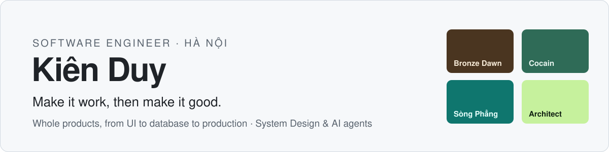
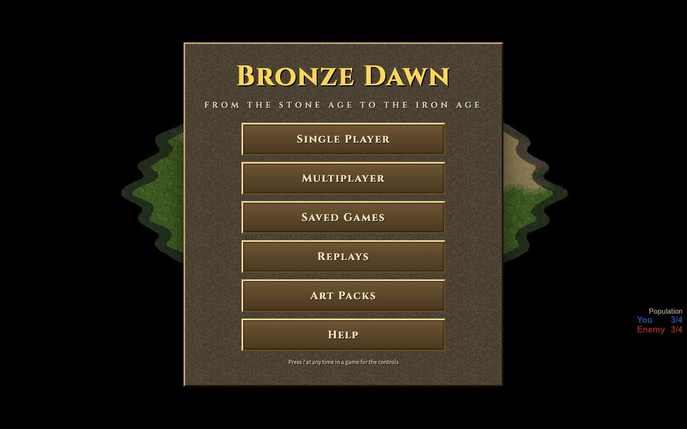
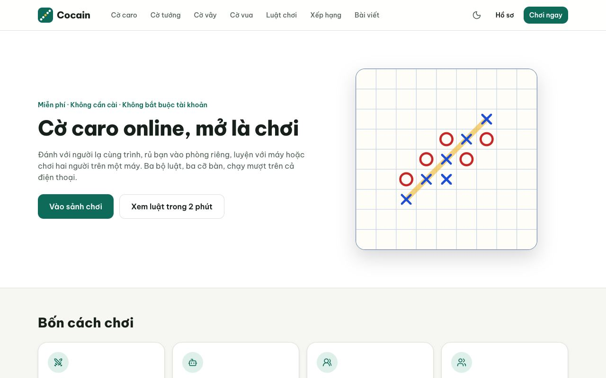
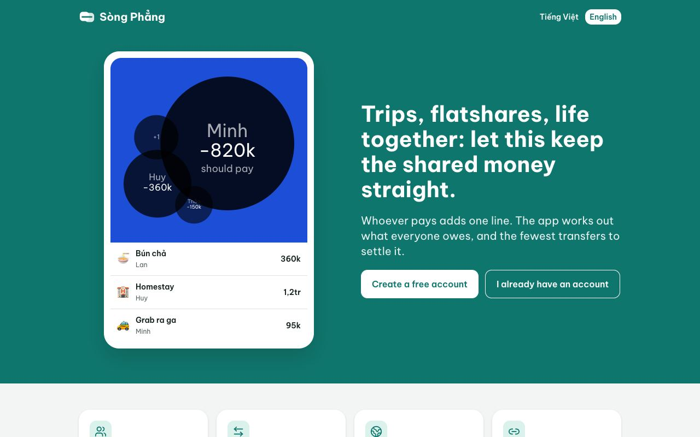
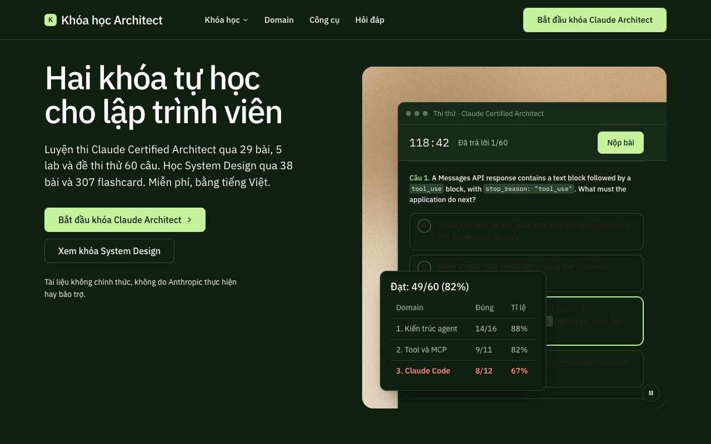

🎨 Style: <a href="https://github.com/kien-duy/kien-duy/blob/main/styles/minimal.md">Minimal</a> · <b>Balanced</b> · <a href="https://github.com/kien-duy/kien-duy/blob/main/styles/fancy.md">Fancy</a>

<picture>
  <source media="(prefers-color-scheme: dark)" srcset="assets/banner-dark.svg">
  
</picture>

Hi, I'm **Kiên Duy**, a software engineer in Hà Nội who likes building whole products: the interface, the server, the database, and shipping it for real people to use. Almost everything below is live. Lately I've been going deep on **System Design** and **AI agents**.

🇻🇳 <a href="https://kien-duy.github.io/portfolio/?lang=vi">Tiếng Việt</a> · 🇯🇵 <a href="https://kien-duy.github.io/portfolio/?lang=ja">日本語</a> · 🌐 <a href="https://kien-duy.github.io/portfolio/">Portfolio</a>

### Stack

### Projects

<table>
  <tr>
    <td width="50%" valign="top">
      
      <h4>Bronze Dawn</h4>
      Stone Age real-time strategy that runs in the browser: 4 ages, 33 units, 65 technologies, computer opponents at 5 levels and peer-to-peer multiplayer. Every sprite is pixel art drawn in code.  
      TypeScript · PixiJS · PeerJS · Swift · Playwright  
      <a href="https://bronzedawn.pages.dev/"><b>▶ Play now</b></a>
    </td>
    <td width="50%" valign="top">
      
      <h4>Cocain</h4>
      Board games online in Vietnamese: gomoku (caro), xiangqi, Go and chess. Ranked Elo matches, private rooms by link, and a Go engine built on Monte Carlo tree search.  
      Next.js · Socket.IO · PostgreSQL · Drizzle · Playwright  
      <a href="https://cocain-394370752419.asia-southeast1.run.app/"><b>▶ Play now</b></a>
    </td>
  </tr>
  <tr>
    <td width="50%" valign="top">
      
      <h4>Sòng Phẳng</h4>
      Group expense splitter: whoever pays adds a line, and the app works out the fewest transfers to settle up, with VietQR codes any Vietnamese banking app can scan. Installable as a PWA.  
      Next.js · PostgreSQL · Web Push · PWA · Cloud Run  
      <a href="https://songphang-637431531944.asia-southeast1.run.app/"><b>▶ Try it</b></a>
    </td>
    <td width="50%" valign="top">
      
      <h4>Architect courses</h4>
      Two free self-study courses in Vietnamese: Claude Certified Architect prep (29 lessons, 5 labs, a 60-question mock exam) and System Design (38 lessons, 307 flashcards). Unofficial.  
      Astro · Starlight · GitHub Actions · GitHub Pages  
      <a href="https://kien-duy.github.io/architect-courses/"><b>▶ Start learning</b></a> · <a href="https://github.com/kien-duy/architect-courses">Source</a>
    </td>
  </tr>
</table>

Bronze Dawn, Cocain and Sòng Phẳng: source is private, available on request.

**Other:** SwipeDelete, an iPhone photo cleaner (coming to the App Store) · [ke-truyen](https://github.com/kien-duy/ke-truyen), a web comic reader for image folders in iPhone Files · [vietnamese-typing-test](https://github.com/kien-duy/vietnamese-typing-test)

### Contact

