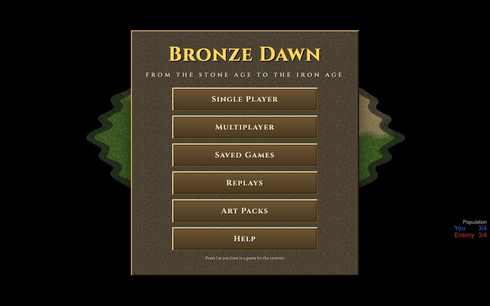
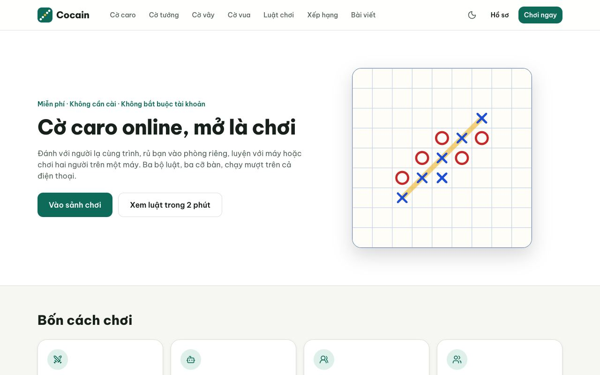
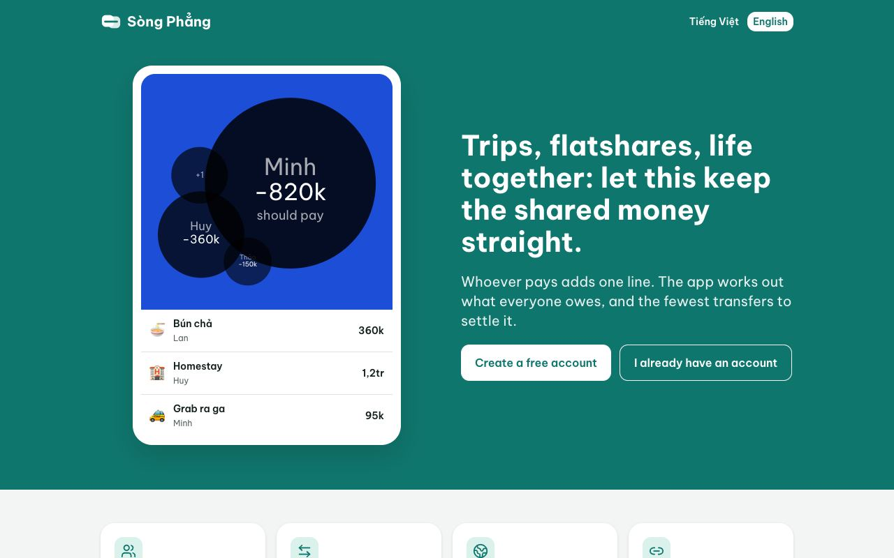
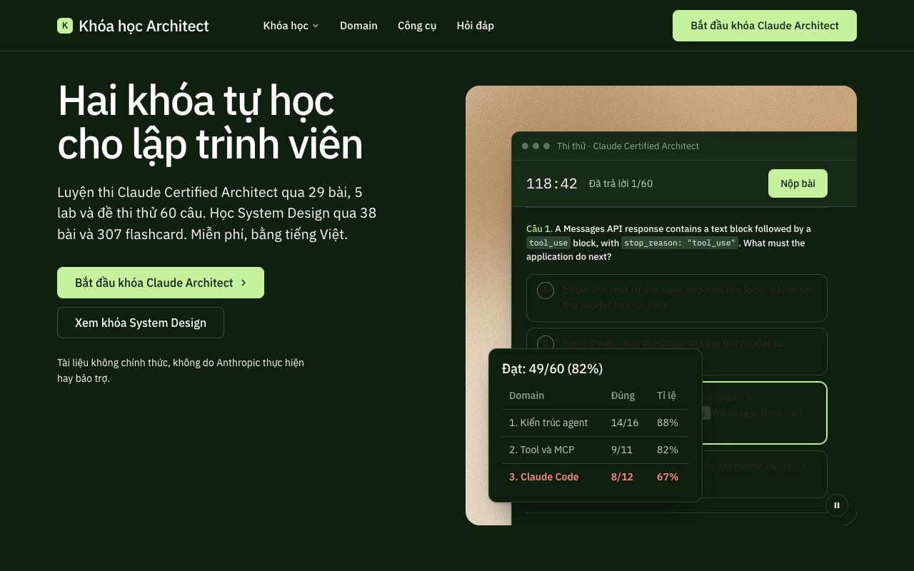

🎨 Style: <a href="https://github.com/kien-duy/kien-duy/blob/main/styles/minimal.md">Minimal</a> · <a href="https://github.com/kien-duy/kien-duy">Balanced</a> · <b>Fancy</b>

<h1 align="center">Hi, I'm Kiên Duy 👋</h1>

  

  
  
  

🇻🇳 <a href="https://kien-duy.github.io/portfolio/?lang=vi">Tiếng Việt</a> · 🇯🇵 <a href="https://kien-duy.github.io/portfolio/?lang=ja">日本語</a>

## 🛠️ Stack

  
  
  
  
  
  
  
  
  
  
  
  
  
  

## 🚀 Live projects

| | |
|:--|:--|
|  | **⚔️ [Bronze Dawn](https://bronzedawn.pages.dev/)** Stone Age RTS in the browser: 4 ages, 33 units, 65 technologies, 16 civilizations, AI at 5 levels, P2P multiplayer. `TypeScript` `PixiJS` `PeerJS` `Swift` |
|  | **♟️ [Cocain](https://cocain-394370752419.asia-southeast1.run.app/)** Gomoku, xiangqi, Go and chess online. Elo ranking, invite links, MCTS Go engine, screen-reader friendly. `Next.js` `Socket.IO` `PostgreSQL` `Drizzle` |
|  | **💸 [Sòng Phẳng](https://songphang-637431531944.asia-southeast1.run.app/)** Split group expenses and settle up in the fewest transfers. VietQR, push reminders, installable PWA. `Next.js` `PostgreSQL` `Web Push` `PWA` |
|  | **🧠 [Architect courses](https://kien-duy.github.io/architect-courses/)** · [source](https://github.com/kien-duy/architect-courses) Free Vietnamese courses: Claude Certified Architect prep (29 lessons, 60-question mock exam) and System Design (38 lessons, 307 flashcards). Unofficial. `Astro` `Starlight` `GitHub Pages` |

🔒 Bronze Dawn, Cocain and Sòng Phẳng: source is private, available on request.

**🧩 Other:** 📱 SwipeDelete (coming to the App Store) · 📚 [ke-truyen](https://github.com/kien-duy/ke-truyen) · ⌨️ [vietnamese-typing-test](https://github.com/kien-duy/vietnamese-typing-test)

## 🐍 Contributions

<picture>
  <source media="(prefers-color-scheme: dark)" srcset="https://raw.githubusercontent.com/kien-duy/kien-duy/output/github-snake-dark.svg">
  
</picture>
